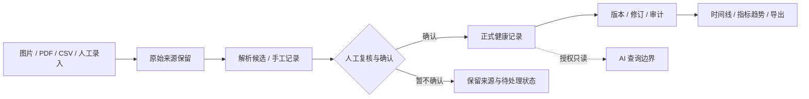

<!-- Modified for the HealthBox distribution; differs from MediKeep v0.68.0. See NOTICE and MODIFICATIONS.md. -->
<div align="center">
  
  <h1>HealthBox · 健康档案盒</h1>
  <p><strong>让每一份健康记录，都成为可以长期积累的个人资产。</strong></p>
  <p>面向个人与家庭的开源、自托管健康档案工作台。<br>
  从原始报告到可信记录，从单次检查到长期趋势，让健康信息真正回到自己手中。</p>
  <p>
    <strong>简体中文</strong> · <a href="README_EN.md">English</a>
  </p>
  <p>
    <a href="LICENSE"></a>
    
    
  </p>
  <p>
    <a href="#为什么是-healthbox">为什么做</a> ·
    <a href="#产品理念">产品理念</a> ·
    <a href="#核心能力">核心能力</a> ·
    <a href="#系统设计">系统设计</a> ·
    <a href="#快速开始">快速开始</a> ·
    <a href="#文档导航">文档导航</a>
  </p>
</div>

---

## 为什么是 HealthBox？

一个人的健康历史，不应只存在于一次次就诊和一叠叠检查单中。

体检报告保存在手机里，化验结果散落在不同医院，平时的体重、血压和症状又记录在别处。**我们拥有越来越多健康数据，却很难持续理解自己的健康历史。**

当几年后想回顾某项指标的变化、向医生说明过去的检查情况，或者帮助家人整理资料时，真正缺少的往往不是一份新报告，而是**一份有时间、有来源、能够被核对和继续使用的长期档案**。

> **HealthBox 想做的是个人与家庭的长期健康记忆。**
>
> 不只是保存文件，也不只是生成图表，而是把原始资料、经确认的健康事实、时间线、共享边界和数据退出能力组织成一个完整系统。

<div align="center">
  <strong>保留原件 → 提取候选 → 人工复核 → 正式入档 → 趋势回看 → 导出与备份</strong>
</div>

## 产品理念

| | |
| :--- | :--- |
| **01 · 原件是证据，结构化记录是索引** | 报告图片和 PDF 不能在识别后就被丢弃。原件负责提供依据，结构化数据负责检索、比较与长期使用；两者需要保持可追溯关联。 |
| **02 · 先确认事实，再分析健康** | 手工录入、CSV 导入或 OCR 解析都可能出错。待确认的数据必须经过明确复核和提交，之后的更正也应保留修订过程。 |
| **03 · 关注长期变化，而非孤立数值** | 真实观测日期、指标单位、历史版本和来源，决定了长期趋势是否值得信任。图表应该帮助回看，而不是替代原始证据。 |
| **04 · 数据属于个人，分享应有边界** | 家庭成员拥有自己的健康主体；共享是明确授权的有限查看，而不是一个账户获得所有人的文件与隐私记录。 |
| **05 · AI 是解释入口，不是诊断权威** | AI 可以基于授权的正式记录辅助查询与组织信息，却不能绕过复核直接改变健康事实，更不能据此给出未经验证的临床结论。 |
| **06 · 数据必须能够离开系统** | 导出、备份、校验和隔离恢复，和录入功能同样重要。健康档案应能够随着时间迁移，而不是被绑定在一次部署中。 |

## 核心能力

<table>
<tr>
<td width="50%" valign="top">
  <h3>01 · 集中管理健康原始资料</h3>
  <p>保存报告图片与 PDF，支持批量上传、进度查看、失败重试、文件哈希、重复内容复核及可撤回的来源管理。</p>
</td>
<td width="50%" valign="top">
  <h3>02 · 让记录经过可信复核</h3>
  <p>支持人工录入、CSV 导入，以及有限范围的本地 PDF/OCR 候选提取。确认后正式提交；修订保留历史，避免“识别到”直接变成“已确诊”。</p>
</td>
</tr>
<tr>
<td valign="top">
  <h3>03 · 看见时间线和长期趋势</h3>
  <p>按真实观测日期整理结构化数据，查看选定指标的变化、对比和详情，并提供 CSV、SVG 与打印出口。</p>
</td>
<td valign="top">
  <h3>04 · 管理家庭档案与访问范围</h3>
  <p>独立邀请账号、成员自己的档案、管理员双向共享组、受限结构化面板与管理员 MFA，让“家人之间可看什么”成为明确的系统规则。</p>
</td>
</tr>
<tr>
<td valign="top">
  <h3>05 · 保留可迁移的数据所有权</h3>
  <p>支持个人档案导出、完整备份、哈希校验和隔离恢复演练；把运营恢复能力纳入个人健康数据的生命周期。</p>
</td>
<td valign="top">
  <h3>06 · 为受控 AI 留出入口</h3>
  <p>独立的只读 AI 合约与回答历史；当前面向“最近有哪些变化”的有界查询设计。模型默认关闭，正式健康数据写入不交给模型。</p>
</td>
</tr>
</table>

**适用场景：** 整理历年体检报告、回看多个日期的检测指标、维护家庭成员各自的健康档案、准备就诊时所需的历史资料，以及将本人数据导出到其他工具进行进一步整理。

## 系统设计

### 从“上传一个文件”到“确认一条健康事实”



这个边界很重要：**来源、候选数据、已确认事实和 AI 回答，并不是同一种东西。**

- **来源不会因解析失败而消失。** 不熟悉的医院版式和指标，可以保留原件、等待后续人工处理。
- **正式记录不能静默被替换。** 更正需要版本与依赖保护，避免悄悄改写健康历史。
- **家庭共享不自动扩散。** 成员仅能查看获授权的结构化信息，不能因此获得原件、私人叙述或 AI 历史。
- **AI 不持有正式写入权限。** 当前模型接口默认关闭，真实模型质量与临床效用仍需独立验证。

### 技术架构

| 层次 | 主要技术与职责 |
| :--- | :--- |
| **前端** | React · TypeScript · Vite · Mantine：健康面板、资料复核、趋势与家庭界面 |
| **后端** | Python · FastAPI · SQLAlchemy / Alembic：业务规则、身份、修订与审计 |
| **数据** | PostgreSQL · 私有上传存储 · 后台任务：原件、结构化记录与处理任务 |
| **解析** | PDF 文本处理 · Tesseract / OCR：产生需要确认的候选数据 |
| **交付** | Docker Compose：本地自托管与独立数据卷 |

[架构与数据归属](docs/healthbox/ARCHITECTURE.md) · [隐私及 AI 边界](docs/healthbox/PRIVACY_AND_AI.md) · [备份与运维](docs/healthbox/OPERATIONS.md)

## 快速开始

使用 **Docker Engine / Docker Desktop 和 Docker Compose v2**，从一份独立的测试实例开始。

**1. 准备配置：** 将项目根目录的 `.env.example` 复制为 `.env`，为 `DB_PASSWORD`、`SECRET_KEY`、`ADMIN_DEFAULT_PASSWORD` 分别生成不同的强随机值。不要把 `.env` 提交到 Git。

**2. 构建并启动：**

```bash
docker compose -f compose.healthbox.yml config --quiet
docker compose -f compose.healthbox.yml up --build -d
docker compose -f compose.healthbox.yml ps
```

**3. 打开：** http://127.0.0.1:18085

使用配置的管理员凭据登录，按提示修改初始密码，然后创建**虚构成员和虚构健康资料**，体验上传、复核、提交、趋势、导出这一完整流程。

本地 Compose 不对外发布 PostgreSQL 端口，使用独立命名卷。停止容器不会自动删除数据；如需保留数据，请勿随意使用 `down -v`。

完整步骤请阅读 [Quick Start](docs/healthbox/QUICK_START.md)。

## 项目阶段与演进

HealthBox 是一套**正在持续开发的开源健康档案系统**。当前公开版本提供前后端源代码、数据模型、家庭共享与导入复核流程，但**源码公开不等于已通过真实健康资料或互联网生产部署的安全验收**。

现阶段的重点包括：完善依赖安全和测试覆盖、扩大报告解析兼容范围、验证数据库及附件的恢复流程、改进移动端体验，以及建立有来源、有版本的健康信息辅助查询能力。

<details>
<summary><strong>查看当前验证边界</strong></summary>

- OCR 只覆盖有限格式和项目，复杂扫描件与任意医院模板不保证可靠。
- 发布版使用独立编写的最小医学标签集；**不包含**可直接用于临床判断的完整参考区间、标准编码或个体化筛查计划。
- AI 默认关闭，目前没有通过现行完整质量门禁的真实模型；工程测试替身不是医学能力验证。
- 现有测试覆盖率与依赖安全门禁仍有未解决项，不能把这个版本视为生产就绪的诊疗系统。
- 本项目不提供诊断、治疗决策或紧急监测服务。

[已知问题及工程状态](docs/healthbox/KNOWN_ISSUES.md) · [发布前核对清单](PUBLIC_RELEASE_CHECKLIST.md) · [路线图](ROADMAP.md)

</details>

## 文档导航

| 想了解什么 | 对应文档 |
| :--- | :--- |
| **如何运行和体验** | [本地启动指南](docs/healthbox/QUICK_START.md) |
| **原件、记录、复核如何关联** | [架构与数据归属](docs/healthbox/ARCHITECTURE.md) |
| **家庭分享与 AI 的权限边界** | [隐私与 AI](docs/healthbox/PRIVACY_AND_AI.md) |
| **怎么备份、更新、恢复** | [运行与运维](docs/healthbox/OPERATIONS.md) |
| **贡献、问题与规划** | [贡献指南](CONTRIBUTING.md) · [问题清单](docs/healthbox/KNOWN_ISSUES.md) · [路线图](ROADMAP.md) |
| **项目来源与许可** | [上游归属](ACKNOWLEDGEMENTS.md) · [修改说明](MODIFICATIONS.md) · [NOTICE](NOTICE) |

## 开源归属

HealthBox 基于 **[MediKeep](https://github.com/afairgiant/MediKeep)**（© 2025 Alex Fair，Apache-2.0）开发。原有的健康档案领域、FastAPI/React 应用基础、附件、报告和备份能力来自上游；HealthBox 在此基础上重点扩展了**家庭共享、保留来源且先复核的导入、正式指标修订链、中文轻量面板以及受控只读 AI 合约**。

本项目是独立的衍生发行版，不代表获得上游官方背书。上游版权、原始许可证和本项目修改记录均予以保留。

---

<div align="center">
  <strong>让健康信息不再散落，让自己的健康历史始终有据可循。</strong>
  <p><sub>HealthBox · Apache-2.0 · <a href="LICENSE">License</a> · <a href="README_EN.md">English</a> · <a href="SECURITY.md">Security</a></sub></p>
</div>
