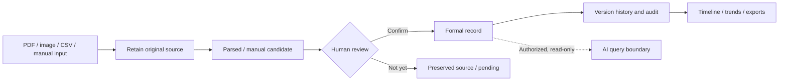

# HealthBox · Personal & Family Health Records

<div align="center">
  
  <h1>HealthBox</h1>
  <p><strong>Keep your health history together, traceable, and yours.</strong></p>
  <p>An open-source, self-hosted health records workspace for individuals and families.<br>
  From original reports to reviewed records, from isolated test results to longitudinal context.</p>
  <p><a href="README.md">简体中文</a> · <strong>English</strong></p>
  <p>
    <a href="LICENSE"></a>
    
    
  </p>
</div>

---

## Why HealthBox?

Lab reports, scans, hospital portals and everyday measurements are often spread across devices and years. Having records is not the same as being able to understand a health history.

**HealthBox brings documents, reviewed health facts, timelines, controlled family access and data portability into one long-lived personal workspace.**

> **Keep the original. Verify the interpretation. Own the record.**

**Source → Candidate → Human review → Confirmed record → Trends → Export & backup**

## Product philosophy

| Principle | What it means |
| :--- | :--- |
| **Evidence first** | Keep original PDFs/images alongside structured information; extraction never makes the source obsolete. |
| **Review before truth** | OCR, CSV imports and manual candidates require appropriate confirmation; corrections preserve revision history. |
| **Longitudinal by design** | Real observation dates, units and provenance matter more than a pretty chart drawn from uncertain numbers. |
| **Ownership with bounded sharing** | Each household member retains their own records; reciprocal structured sharing does not mean unrestricted access. |
| **AI without clinical authority** | Read-only AI contracts can help explore confirmed information, but cannot write records or replace clinical judgment. |
| **Exit is a feature** | Exports, verifiable backups and independent restore rehearsals protect long-term ownership. |

## What HealthBox brings together

<table>
<tr>
<td width="50%" valign="top">
<h3>01 · Original health sources</h3>
<p>Preserve images and PDFs with multi-file upload, progress/retry, file hashes, duplicate review and reversible source withdrawal.</p>
</td>
<td width="50%" valign="top">
<h3>02 · Reviewed, versioned records</h3>
<p>Manual/CSV entry and limited local PDF/OCR parsing produce reviewable candidates. Explicit commits and revision trails separate extraction from confirmed facts.</p>
</td>
</tr>
<tr>
<td valign="top">
<h3>03 · Timelines and trends</h3>
<p>Review measurements using their real observation dates, compare selected metrics and export CSV, SVG or printable views.</p>
</td>
<td valign="top">
<h3>04 · Household sharing</h3>
<p>Invited accounts, per-member ownership, reciprocal sharing circles, limited structured dashboards and administrator MFA.</p>
</td>
</tr>
<tr>
<td valign="top">
<h3>05 · Portable archives</h3>
<p>Personal archive exports, full application backups, hash verification and independent restoration workflows.</p>
</td>
<td valign="top">
<h3>06 · Governed AI integration</h3>
<p>A separately bounded, read-only recent-changes adapter and answer history. AI is off by default and cannot alter formal health facts.</p>
</td>
</tr>
</table>

## How information becomes a trusted record



**Original evidence, tentative extraction, canonical health facts and AI output never share the same authority.** A failed parser does not delete its source; correction must respect revision and dependency rules; family sharing has bounded scope.

### Technology

| Layer | Stack and responsibility |
| :--- | :--- |
| **Web** | React · TypeScript · Vite · Mantine: dashboards, review and family experience |
| **Backend** | Python · FastAPI · SQLAlchemy / Alembic: identities, rules and revisions |
| **Data** | PostgreSQL · private file storage · database-backed background tasks |
| **Parsing** | PDF extraction · Tesseract / OCR: provisional, review-first candidates |
| **Operations** | Docker Compose: locally isolated self-hosted instance and persistent volumes |

[Architecture](docs/healthbox/ARCHITECTURE.md) · [Privacy & AI](docs/healthbox/PRIVACY_AND_AI.md) · [Operations](docs/healthbox/OPERATIONS.md)

## Quick start

Requires **Docker Engine/Desktop and Docker Compose v2**.

1. Copy root `.env.example` to `.env`.
2. Generate **three distinct random secrets** for `DB_PASSWORD`, `SECRET_KEY` and `ADMIN_DEFAULT_PASSWORD`; never commit the environment file.
3. Start the self-contained local trial:

```bash
docker compose -f compose.healthbox.yml config --quiet
docker compose -f compose.healthbox.yml up --build -d
docker compose -f compose.healthbox.yml ps
```

Open **http://127.0.0.1:18085**, sign in with the configured administrator credentials, change the initial password, and use **synthetic member and medical data** to exercise the complete upload → review → commit → trend → export path.

The provided local Compose does not publish PostgreSQL; volumes persist when containers stop. Do not use `down -v` if you need the stored data.

[Full local startup guide](docs/healthbox/QUICK_START.md)

## Project stage

HealthBox is an **actively evolving source-available open-source health records system**, not an approved clinical or internet-facing production deployment. The public codebase includes the application, migrations, import/review workflows and supporting infrastructure; its existing dependency, coverage and restore-acceptance gates remain visible.

<details>
<summary><strong>Engineering and medical limitations</strong></summary>

- OCR supports a limited set of paths and metrics, not arbitrary clinical formats or handwriting.
- Public starter catalogs contain minimal independently written labels, not comprehensive standards, normal ranges or personalized screening recommendations.
- AI remains disabled by default; no real model has passed the complete current quality gate. Synthetic model test doubles do not establish medical quality.
- Outstanding dependencies, test coverage and runtime restoration checks prevent production readiness claims.
- This is not a diagnostic, treatment decision or emergency monitoring system; use synthetic data for evaluation.

[Known issues](docs/healthbox/KNOWN_ISSUES.md) · [Release checklist](PUBLIC_RELEASE_CHECKLIST.md) · [Roadmap](ROADMAP.md)

</details>

## Project documentation

| Topic | Read |
| :--- | :--- |
| Start and test | [Quick start](docs/healthbox/QUICK_START.md) |
| Data integrity | [Architecture & ownership](docs/healthbox/ARCHITECTURE.md) |
| Sharing and AI | [Privacy & AI limits](docs/healthbox/PRIVACY_AND_AI.md) |
| Backup and upgrade | [Operations](docs/healthbox/OPERATIONS.md) |
| Roadmap and contribution | [Roadmap](ROADMAP.md) · [Contributing](CONTRIBUTING.md) |
| Attribution and licensing | [Acknowledgements](ACKNOWLEDGEMENTS.md) · [Modifications](MODIFICATIONS.md) · [NOTICE](NOTICE) |

## Upstream attribution

HealthBox is a derivative of **[MediKeep](https://github.com/afairgiant/MediKeep)**, © 2025 Alex Fair, licensed Apache-2.0. Core record domains, the initial FastAPI/React application, attachments, reporting and backup features originate upstream. HealthBox's household-focused changes include reciprocal sharing, review-first source imports, revisioned formal observations, a lightweight Chinese dashboard and bounded read-only AI contracts.

This derivative is independent of and not officially endorsed by the upstream author. Original attribution and license notices are preserved in the repository.

---

<div align="center">
  <strong>Your health history, with its evidence, context and ownership intact.</strong>
  <p><sub>HealthBox · Apache-2.0 · <a href="LICENSE">License</a> · <a href="README.md">简体中文</a> · <a href="SECURITY.md">Security</a></sub></p>
</div>
